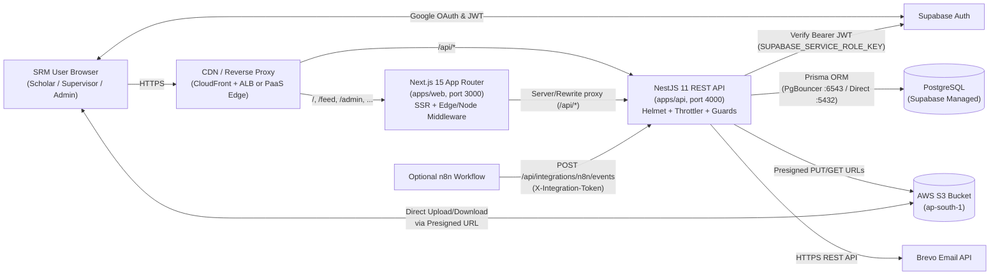
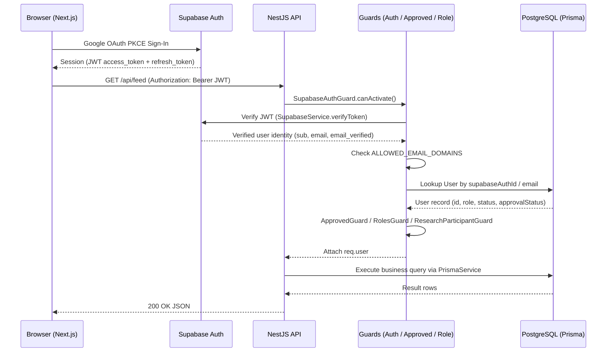

# CuriousBees — System Architecture

**Related:** [PROJECT_OVERVIEW.md](./PROJECT_OVERVIEW.md) | [SECURITY_AND_ACCESS_CONTROL.md](./SECURITY_AND_ACCESS_CONTROL.md) | [DATABASE_AND_BACKUP_GUIDE.md](./DATABASE_AND_BACKUP_GUIDE.md)

---

## 1. High-Level Architecture

CuriousBees is a TypeScript monorepo (`npm` workspaces) composed of two deployable applications (`apps/web` and `apps/api`) sharing four internal workspace packages (`@curiousbees/types`, `@curiousbees/constants`, `@curiousbees/shared-utils`, `@curiousbees/ui`), backed by Supabase (Auth + PostgreSQL), AWS S3 (object storage), and Brevo (transactional email).

## 2. Frontend Architecture (`apps/web`)

- **Framework:** Next.js `^15.3.0` App Router configured with `output: 'standalone'` (unless `VERCEL` env is set) in [`apps/web/next.config.ts`](../../apps/web/next.config.ts).
- **Route Groups:**
  - `(marketing)/`: Public landing, about, institution, research, education, contact, legal pages.
  - `(auth)/`: `/login`, `/onboarding`, `/verification-pending`, `/account-rejected`, plus `/auth/callback` (Supabase OAuth PKCE code exchange) and status routes (`/access-denied`, `/account-suspended`, `/not-provisioned`, `/approval-pending`, `/awaiting-supervisor-approval`).
  - `(portal)/`: Authenticated application shell (`(portal)/layout.tsx`) with role-aware navigation, `/feed`, `/researchers`, `/my-research`, `/workspace`, `/publications`, `/events`, `/opportunities`, `/nexus`, `/supervisor`, `/my-scholars`, `/admin/*`, `/profile`, `/settings`.
- **Middleware (`apps/web/src/middleware.ts`):** Runs on the `nodejs` runtime (`runtime: 'nodejs'`). Refreshes Supabase SSR cookies via `updateSession`, redirects unauthenticated users on protected routes to `/login`, and performs an early UX check on `ALLOWED_EMAIL_DOMAINS`.
- **State & Data Fetching:** Zustand (`apps/web/src/store/useStore.ts`), TanStack React Query, and `apiFetch` (`apps/web/src/lib/api-client.ts`) which attaches the Supabase `access_token` as `Authorization: Bearer <token>`.
- **API Proxy Rewrite:** `next.config.ts` rewrites `/api/:path*` to `${API_URL || NEXT_PUBLIC_API_URL || 'http://localhost:4000'}/api/:path*`.

## 3. Backend Architecture (`apps/api`)

- **Framework:** NestJS `^11.1.24` on Express (`apps/api/src/main.ts`).
- **HTTP Pipeline (`configureApp`):**
  1. `trust proxy` set from `TRUST_PROXY_HOPS` (`0`–`5`) so `req.ip` reflects the real client behind CloudFront/ALB.
  2. `helmet` security headers + `compression`.
  3. Global prefix `/api` (excluding `/`, `/health`, `/health/live`, `/health/ready`, `/api/health*`, `/api/system`, `/api/version`).
  4. `ValidationPipe({ whitelist: true, transform: true, forbidNonWhitelisted: true })`.
  5. `HttpExceptionFilter` for standardized JSON error responses without leaking stack traces in production.
  6. Explicit CORS allow-list (`getAllowedOrigins()` from `FRONTEND_URL` + `ALLOWED_ORIGINS`, no wildcards).
  7. Swagger UI at `/api/docs` when `NODE_ENV !== 'production'` or `ENABLE_SWAGGER === 'true'`.
- **Rate Limiting (`apps/api/src/common/throttling/rate-limits.ts`):** In-memory per-instance `@nestjs/throttler` keyed by SHA-256 hash of bearer token (authenticated) or `req.ip` (anonymous), plus a per-IP ceiling (`RATE_LIMIT_IP_TOTAL=6000`).
- **Scheduled Jobs (`apps/api/src/notifications/digest.scheduler.ts`):** `@Cron(EVERY_DAY_AT_8AM)` using PostgreSQL `pg_try_advisory_xact_lock`, active in production only when `ENABLE_CRON === 'true'`.

## 4. Authentication & Request Lifecycle

**Fail-Closed Design:**
- A valid Supabase JWT only proves identity; `SupabaseAuthGuard` rejects unprovisioned users (`USER_NOT_PROVISIONED`), disallowed domains (`EMAIL_DOMAIN_NOT_ALLOWED`), unverified emails (`EMAIL_NOT_VERIFIED`), suspended users (`USER_SUSPENDED`), and deactivated/rejected users (`USER_DEACTIVATED`).
- If Supabase Auth is unreachable, `SupabaseAuthGuard` returns `503 Service Unavailable` (`AUTH_SERVICE_UNAVAILABLE`) instead of `401` so users are not logged out during transient auth outages.
- **Note on Local Demo Fallback:** In `PrismaService.onModuleInit()`, if `this.$connect()` fails at startup, NestJS logs a warning and continues in fallback mode rather than crashing; `/api/health/ready` returns `503` whenever `SELECT 1` fails.

## 5. Authorization & Role-Based Access

- **`@Public()`:** Marks unauthenticated endpoints (e.g., health checks). Note: `ThreadsPublicController` (`/api/threads/public/*`) also has no auth guard by design for share links.
- **`@Roles(...)` + `RolesGuard`:** Restricts admin endpoints (`/api/admin/*`) to `Role.INSTITUTE_ADMIN` and supervisor endpoints to `Role.RESEARCH_SUPERVISOR`.
- **`ResearchParticipantGuard`:** Blocks `INSTITUTE_ADMIN` from participating in research/social mutations (creating threads, comments, likes, bookmarks, follows, collaborations, workspaces, publications).

## 6. Database, Storage & External Dependencies

- **Database (`apps/api/prisma/schema.prisma`):** 40+ Prisma models covering identity (`User`, `ScholarProfile`, `SupervisorProfile`), SRM hierarchy (`Campus`, `Faculty`, `Department`), social (`Thread`, `Comment`, `ThreadLike`, `SavedThread`, `UserFollow`), supervision (`ResearchProfile`, `ResearchMilestone`, `ScholarSupervisorRequest`, `Report`), workspaces (`Workspace`, `WorkspaceMember`, `WorkspaceFile`), publications, opportunities, events (`Event`, `EventIngestion`), notifications, integrations, and `AuditLog`.
- **File Storage (`apps/api/src/files/files.service.ts`):** Uses AWS S3 presigned `PUT` (upload) and `GET` (download) URLs so binary files never stream through the NestJS API. Workspace uploads are capped at `50 MB` with an executable/script extension blocklist.
- **Email (`apps/api/src/users/mail.service.ts`):** Sends transactional emails via Brevo's `/v3/smtp/email` HTTPS endpoint (`BREVO_API_KEY`). Logs delivery status to `NotificationLog`.
- **Optional Integrations:**
  - **OpenSearch (`OPENSEARCH_ENDPOINT`):** Optional search backend; falls back to PostgreSQL `Prisma` queries if unset.
  - **n8n Event Ingestion (`N8N_INTEGRATION_TOKEN`):** Receives normalized academic event payloads at `/api/integrations/n8n/events` into `EventIngestion` for admin review.
  - **Google Workspace (`GOOGLE_CLIENT_ID`, `GOOGLE_CLIENT_SECRET`):** Optional OAuth integration for Meet/Calendar/Chat links.
