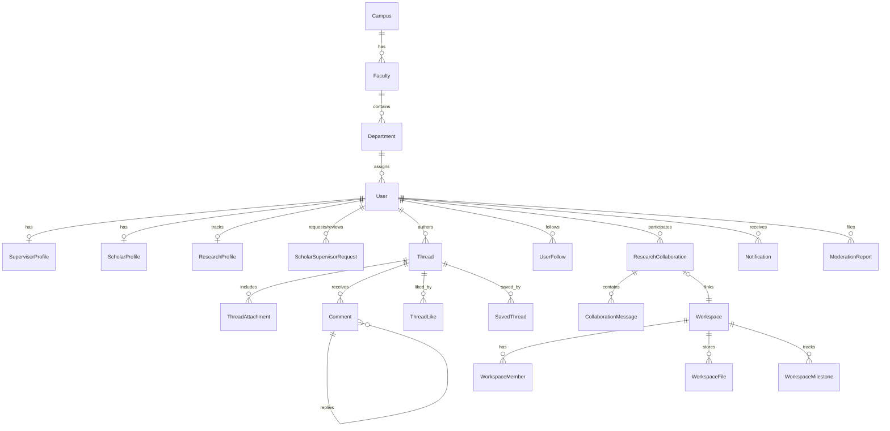

# CuriousBees — Database Documentation

## 1. Database Technology
- **DBMS:** PostgreSQL
- **ORM:** Prisma v6.19.3 (`apps/api/prisma/schema.prisma`)
- **Schema Size:** **54 models** and **21 enums**
- **Migrations (`apps/api/prisma/migrations/`):**
  1. `20260929000000_production_baseline`
  2. `20261001000000_event_email_ingestion`
  3. `20261023000000_remove_zoom_workplace`

---

## 2. Core Model Groups & Relationships

### 2.1 Identity, Roles & Institutional Hierarchy
- **`User`**: Core account (`id` CUID, `supabaseAuthId` unique, `email` unique, `role` `Role` enum, `status` `UserStatus` enum, `approved`, `suspended`, `departmentId` FK -> `Department`, `supervisorId` self-FK -> `User`).
- **`Campus` -> `Faculty` -> `Department`**: Institutional hierarchy (`Faculty.campusId` -> `Campus.id`, `Department.facultyId` -> `Faculty.id` `onDelete: Restrict`).
- **`SupervisorProfile` & `ScholarProfile`**: 1:1 role profiles (`userId` unique FK -> `User`, `facultyId` -> `Faculty`, `departmentId` -> `Department`). `SupervisorProfile` adds `designation`, `employeeId` (unique), `maxScholars`.
- **`ScholarSupervisorRequest`**: Tracks scholar-to-supervisor requests (`scholarId`, `supervisorId`, `status` `RequestStatus`).

### 2.2 Researcher Network & Social Interactions
- **`Thread`**: Research posts (`authorId` FK -> `User`, `type` `ThreadType`, `tags: String[]`, `hidden`, `moderatedAt`, `moderatedBy`, `moderationReason`).
- **`ThreadAttachment`**: `threadId` FK -> `Thread`.
- **`Comment`**: Self-referential nested replies (`threadId` FK -> `Thread`, `authorId` FK -> `User`, `parentId` self-FK -> `Comment`).
- **`ThreadLike`** (`@@unique([threadId, userId])`), **`CommentLike`** (`@@unique([commentId, userId])`), **`SavedThread`** (`@@unique([threadId, userId])`), **`ThreadShare`**, **`ThreadReport`**.
- **`UserFollow`** (`@@unique([followerId, followingId])`), **`DomainFollow`** (`@@unique([userId, domain])`), **`TopicFollow`** (`@@unique([userId, topic])`).

### 2.3 Collaboration, Workspaces & Lifecycle
- **`ResearchCollabRequest`** -> **`ResearchCollaboration`** (`workspaceId` unique FK -> `Workspace`) -> **`CollaborationMessage`**.
- **`CollaborationRequest`**: Tracks `Opportunity` join requests (`scholarId`, `opportunityId`, `threadId`).
- **`Workspace`**: `supervisorId` FK -> `User`, `researchDomainId`, `researchTopicId`; owns **`WorkspaceMember`** (`@@id([workspaceId, userId])`), **`WorkspaceFile`** (`storageKey` unique S3 key), **`WorkspaceMilestone`**, **`WorkspaceAnnouncement`**, **`ResearchMeeting`**.
- **`ResearchProfile`** (`scholarId` unique FK -> `User`) -> **`ResearchMilestone`**, **`ResearchActivity`**.
- **`Publication`** (`userId` FK -> `User`, `hidden`) & **`Report`** (`scholarId`, `supervisorId` FKs -> `User`).

### 2.4 Notifications, Governance & Events
- **`Notification`** (`userId` FK -> `User`, `eventId` optional FK -> `Event`, `type`, `actionUrl`, `readAt`), **`UserPreference`**, **`NotificationToken`**.
- **`ModerationReport`** (`reporterId` FK -> `User`, `targetType`, `targetId`, `status`, `severity`, `resolvedById`).
- **`AuditLog`** (`actorId`, `action`, `targetId`, `targetType`, `category`, `severity`, `previousState`, `newState`).
- **`Event`** & **`EventIngestion`** (`sourceMessageId` unique).

---

## 3. Entity-Relationship Diagram (Core Domain Subset)

