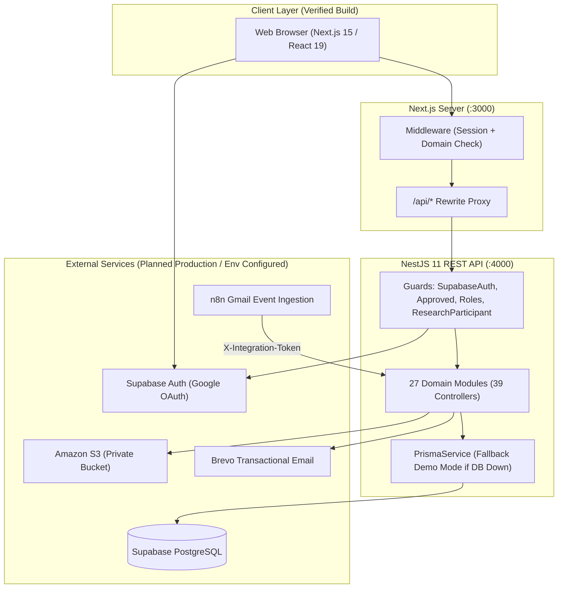
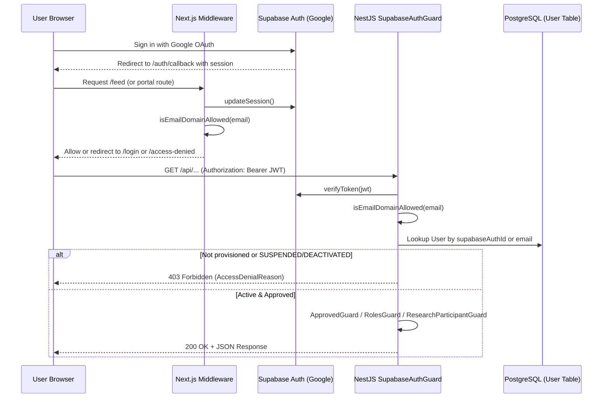
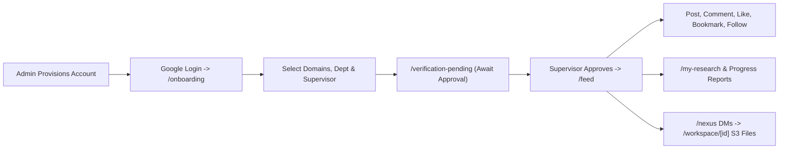
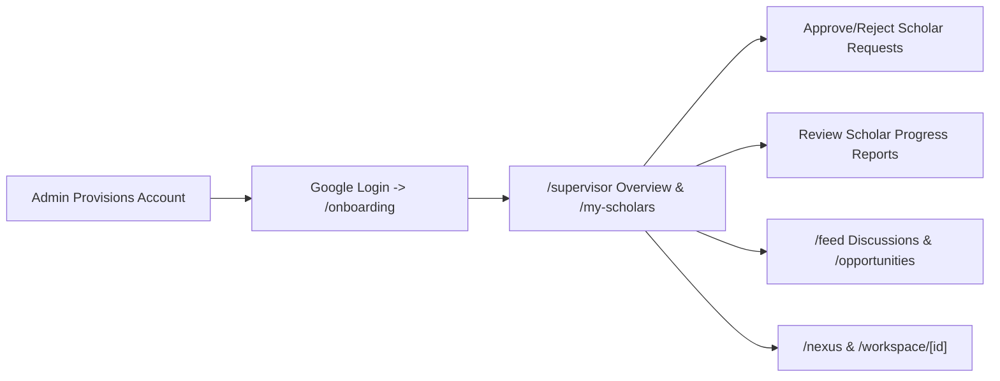
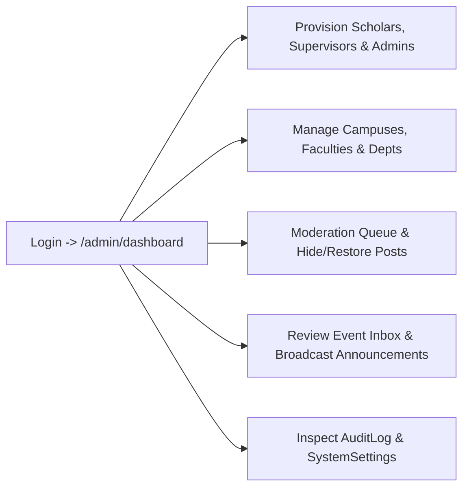

# CuriousBees — System Architecture

## 1. Architecture Overview
CuriousBees uses a **decoupled monorepo architecture**:
- **Frontend (`apps/web`):** Next.js 15 App Router (`:3000`), React 19, Zustand global state (`useStore.ts`), TanStack React Query, and Edge/Node middleware (`middleware.ts`). Browser requests to `/api/*` are proxied via Next.js `rewrites()` (`next.config.ts`) to the NestJS API.
- **Backend (`apps/api`):** Modular NestJS 11 REST API (`:4000`, global prefix `/api` except health), `ThrottlerModule` rate limiting (`sessionTracker` + `ipTracker`), `Helmet` security headers, `ValidationPipe`, Winston logging, and Swagger (`/api/docs`).
- **Shared Packages (`packages/*`):** `@curiousbees/types`, `@curiousbees/constants`, `@curiousbees/shared-utils` (Zod schemas), and `@curiousbees/ui`.
- **Infrastructure Status:**
  - **Configured & Code-Verified:** Multi-stage Dockerfiles (`Dockerfile.web`, `Dockerfile.api`), Prisma ORM (`schema.prisma`), Supabase JWT verification (`SupabaseService`), S3 presigned URL signing (`FilesService`), Brevo SMTP/API dispatch (`MailService`), and n8n webhook ingestion (`N8nEventsController`).
  - **Planned / Pending Live Credentials:** Production AWS ECS/S3 deployment, active cloud Supabase PostgreSQL (`ndtaxeqsefusocwgqppx.supabase.co` currently unreachable in `.env`), and live Google Workspace OAuth credentials.

---

## 2. Authentication & Authorization Flow

---

## 3. Main Application Request Lifecycle

```mermaid
flowchart LR
    Req["HTTP Request"] --> Helmet["Helmet + CORS + Compression"]
    Helmet --> Throttle["ThrottlerGuard (Session + IP)"]
    Throttle --> Auth["SupabaseAuthGuard (JWT + Provisioned User)"]
    Auth --> Approved["ApprovedGuard (ACTIVE + approved)"]
    Approved --> RoleGuard["RolesGuard / ResearchParticipantGuard"]
    RoleGuard --> Ctrl["Controller + ValidationPipe / Zod"]
    Ctrl --> Svc["Service + PrismaService"]
    Svc --> Res["JSON Response / HttpExceptionFilter"]
```

---

## 4. Role Workflows

### 4.1 Research Scholar Workflow

### 4.2 Research Supervisor Workflow

### 4.3 Institute Admin Workflow

---

## 5. File Storage, Notifications & External Integrations
- **File Storage (`FilesService`):** Private Amazon S3 bucket; server validates file extensions, MIME types, and size limits (`10 MB` for feed attachments under `threads/posts/...`, `50 MB` for workspaces under `workspaces/...`), issuing short-lived presigned `PUT`/`GET` URLs.
- **Notifications (`NotificationsService`):** Persisted in-app `Notification` records + Brevo transactional emails (`MailService`). Browser push delivery (`sendPushToUser`) is disabled (no push provider configured).
- **External Integrations:** Google Workspace OAuth (`IntegrationConnection`) for Google Meet/Chat Space links in workspaces, and `n8n` webhook ingestion (`N8nEventsController`) protected by timing-safe `N8N_INTEGRATION_TOKEN`.
